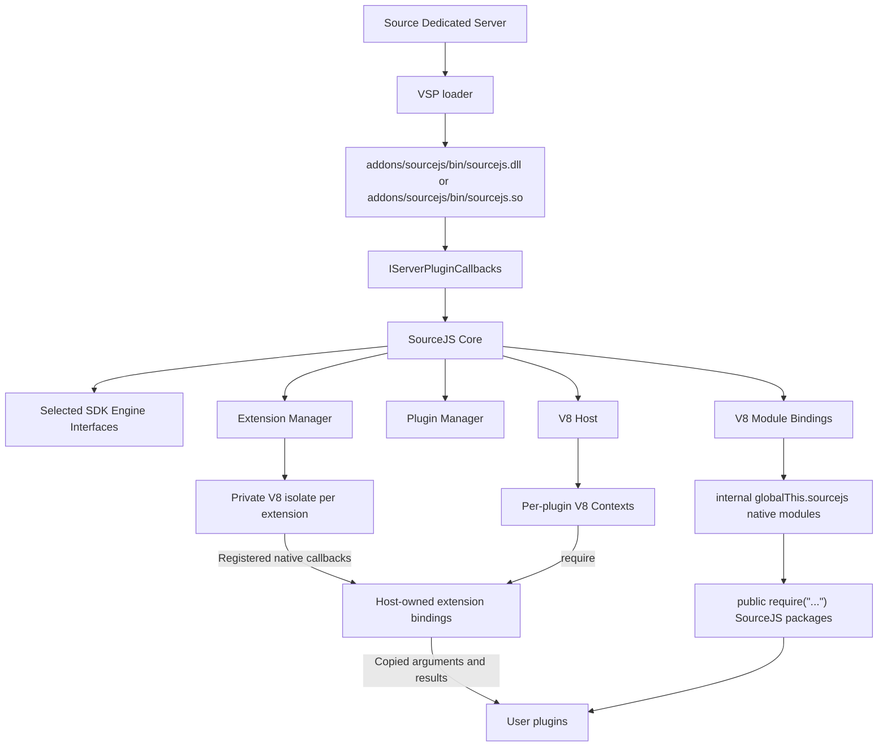

# SourceJS Architecture

> AI navigation: start with Core Decision for runtime ownership and module flow.
> Use its native-contract subsections for failure and memory-access boundaries;
> follow the API links for public signatures and safe-use examples. Consult SDK
> Support for branch/platform availability. Read one bounded section at a time;
> address-range checks and source-contract tests are not live-engine safety proofs.

## Table of Contents

- [Reference Projects](#reference-projects)
- [Core Decision](#core-decision)
  - [Native GameData Contracts](#native-gamedata-contracts)
  - [Native Translation Contracts](#native-translation-contracts)
  - [Native String-Table And Download Contracts](#native-string-table-and-download-contracts)
  - [Native GameRules Contracts](#native-gamerules-contracts)
  - [Native Studio Contracts](#native-studio-contracts)
  - [Native Physics Contracts](#native-physics-contracts)
  - [Native Manager Contracts](#native-manager-contracts)
  - [Native External-IO Contracts](#native-external-io-contracts)
- [Code Style](#code-style)
- [Runtime Layout](#runtime-layout)
- [Native Layers](#native-layers)
- [SDK Branch ABI](#sdk-branch-abi)
- [VSP Entrypoint](#vsp-entrypoint)
- [Selected SDK Interfaces](#selected-sdk-interfaces)
- [V8 Host Model](#v8-host-model)
- [Mandatory External Libraries](#mandatory-external-libraries)
- [Plugin Model](#plugin-model)
- [Extension Model](#extension-model)
- [Runtime Command Model](#runtime-command-model)
- [Object Lifetime Rules](#object-lifetime-rules)
- [Hooking And ABI Calls](#hooking-and-abi-calls)
- [API Shape](#api-shape)
- [Implementation Checkpoints](#implementation-checkpoints)

SourceJS is a Valve Server Plugin (VSP) for Source 1. The engine loads it from
`addons/sourcejs.vdf` at startup, or from the server console with
`plugin_load addons/sourcejs/bin/sourcejs`.

The bootstrap validation branch is Left 4 Dead 2 (`l4d2`). Runtime, packaging,
and CI support only the Source 1 branch/platform/architecture combinations
listed in [SDK Support](sdk-support.md). Source 2 branches such as `cs2`, `dota`
and `deadlock` are excluded because they do not provide the VSP contract used
by SourceJS.

## SDK

- HL2SDK: <https://github.com/alliedmodders/hl2sdk>, with per-game branches

## Core Decision

SourceJS owns the full runtime stack:



The runtime does not use a generic JavaScript native bridge. Each native module
is a real V8 object installed by `src/sourcejs/modules/ModuleBindings.cpp`.
The canonical CommonJS package in `packages/sourcejs` exposes those objects
directly where possible and implements higher-level JavaScript ownership,
collections and lifecycle only where that behavior is genuinely package-side.

Native extensions register C++ callbacks for one private V8 isolate per
load. `src/sourcejs/V8Runtime.cpp` reserves `extensions/<name>/<module>`
for these bindings. It publishes host functions that copy structured values
across isolates; it does not compile extension-supplied source.

SourceJS modules should be native-first. If an API depends on Source SDK,
engine interfaces, Detours, SOCI, redis++ or cpr, the callable implementation
lives in C++. Methods absent from the selected SDK are omitted at compile time.
Synchronous native calls report failures through V8; asynchronous external-I/O
APIs deliver failures through their documented callback contract. JS package
files may shape import ergonomics and pure value objects, but they must not
recreate SDK objects or hide missing runtime APIs behind fake substitutes.

SourceJS provides these runtime systems:

- VSP lifecycle.
- Engine interface lookup.
- Game event listeners.
- Command registration and dispatch.
- Entity/player handles.
- Plugin and extension managers.
- Hooking and detours, when needed.
- GameData/signature loading.

Branch-aware JSON/INI GameData loading is documented in
[`memory/gamedata`](api/memory-gamedata.md); signature resolution and callable
type descriptors are documented in [`memory/manager`](api/memory-manager.md).

### Native GameData Contracts

For the virtual-slot patcher and its validation rules, see [Native GameData](native-gamedata.md).

Private native GameData helpers preserve the original V8 error when property
lookup, branch/platform selection or JSON parsing fails; they stop traversal
instead of treating the failure as a missing field. Native INI parsing creates
checked own data properties, so inherited setters cannot intercept entries,
and preserves the complete key text. The native int32 string resolver rejects
trailing bytes (including embedded NUL) and out-of-range values before committing
its output. Address-record traversal likewise stops on failed getters or
selection instead of trying the next field; module and symbol names containing
NUL are rejected before native string lookup. Invalid BigInt identifiers cannot
fall back to symbol lookup. Native binary records have checked own `Name`,
`Path`, `Address` and `Size` properties; the JavaScript facade exposes `Size` as
`ByteCount` and preserves BigInt addresses. Native binary-list entries, callable
options, file-list records and array entries, and the loaded file's `Path` also
use checked own data properties. Native manager value/function exports are
installed through checked own properties; the established public
`GetPackagedGameDataRootPath` export remains available. A resolved named signature
is not reinterpreted as a raw byte pattern;
an explicit record `Address` retains precedence. Genuine missing optional fields
keep their existing null/skip results, while getter or selection errors stop
before another section or address fallback is tried. These native callback
boundaries translate C++ failures without replacing an already caught V8 error.
Direct symbol lookup rejects embedded NUL in both binary and symbol names.
An unresolved binary, pattern match, symbol or identifier keeps its null result;
a real identifier-conversion error is propagated instead of becoming null.
Native file enumeration retains its error-code policy: unavailable roots are
skipped, permission-denied entries may be skipped, and other traversal errors may
leave a partial list. Scanning checks the complete address
range before byte access; this arithmetic check does not guarantee that the
module remains mapped or readable. These are internal parsing/failure contracts,
not replacements for the JavaScript GameData loader's documented format and
selection rules.

### Native Translation Contracts

Private translation text-file helpers reject empty/NUL-containing paths and
translate C++ failures to `false`. Reads use bounded binary blocks and commit
the output only after complete success, including successful empty-file reads.
Writes check the byte count before stream-size conversion, create required parent
directories, and check the flushed stream result. They retain truncating-write
semantics: a failed write can leave a partial file, not an atomic replacement.
The ensure helper preserves an existing path without overwriting it. Existing
language-file keys and language-code spellings remain unchanged.

Native translation INI parsing stages phrase/default updates before committing
them after a complete parse; a failed stream does not publish partial overrides.
Alias configuration similarly retains built-in defaults when parsing fails.
Malformed records still use the existing skip policy, and successful server
overrides still merge with the main file. Raw paths containing NUL are rejected
before lexical normalization can remove the invalid component; loading such a
path yields empty file metadata/phrases with the selected default language.
Language-state exports use checked own data properties and complete alias keys,
so inherited setters do not intercept their construction. Native formatting
stops on failed enumeration/getters/string conversion, preserves the original
V8 error, and translates native C++ failures rather than returning partial text.
Successful UTF8 conversion preserves complete strings, including embedded NUL;
scanning resumes after inserted text for the same placeholder. Later keys still
follow the original enumeration order and can match text inserted by earlier
replacements. These are private native contracts, not a change to language
selection precedence or file syntax.

Native translation phrase/file records and phrase-key arrays likewise use
checked own data properties with complete dynamic names. The native
`GetLanguages`, `GetLanguage`, `GetDefaultLanguage`, `GetFallbackLanguage`,
`SetDefaultLanguage`, `LoadFile`, `GetPhrase`, `GetPhraseKeys`, and `GetText`
callbacks contain C++ failures and preserve caught V8 errors. String reads
validate UTF8 conversion before committing the complete value. Native
`GetLanguage`/`GetPhrase` retain `null` for genuinely missing values, not for
conversion/build failures. Updating the default language commits its resolved
code before enabling the override. `GetPhraseKeys` reports an unrepresentable
array size; `GetText` preserves a delegated formatting error before attempting
to export text.
Existing configuration/file IO remains synchronous, including best-effort
creation of default configuration and server-override files.

Native `HasPhrase` and `FormatText` also check UTF8 reads and contain native
failures. The four successful phrase/language decisions remain boolean results;
a missing phrase is resolved before inspecting its optional language argument.
`FormatText` preserves a delegated formatting error before creating its result
string. Translation installation retains all eleven callbacks and their runtime
data, using checked own function properties rather than inherited setters.

### Native String-Table And Download Contracts

Native string-table property getters, property installation, descriptor builds,
`GetAllStringTables`, `FindStringTable`, and `GetString` have matching V8/native
error boundaries. Table names are staged from complete UTF8 input and reject
embedded NUL before native C-string lookup. Genuine missing tables and invalid
string indexes retain `null`; failed conversion or result construction is not
reported as absence. Enumeration writes checked own array elements. The five
enumerable read-only, non-deletable native properties retain their selectors and
exact `bigint` address. Descriptors borrow the engine-owned table; these checks
neither extend its lifetime nor detect stale addresses after table destruction.
Discard descriptors before teardown and reacquire them after recreation.

Required-string index validation, required reads, string insertion, acquiring the
downloadables table, string-array construction, and the downloadable table/list,
tracked-list and index callbacks also translate native failures through matching
V8 boundaries. Invalid-index diagnostic conversion retains an existing JavaScript
exception. Required reads keep their nonnegative integral native-int contract
and throw for missing/null/empty entries. Insertion validates complete UTF8/NUL
input before the SDK call, retaining both SDK `AddString` signatures and results.
Download-path normalization and private lookup/insertion helpers reject embedded
NUL before filesystem or native C-string use. Result arrays use checked own indexed
data properties; construction failures are not partial successful snapshots.
Tracking allocation can fail after an irreversible engine insertion; no rollback
or new table-lifetime guarantee is implied.

Downloadable presence/add/untrack/directory/restore callbacks and their installer
have matching V8/native failure boundaries. Paths are fully decoded and reject
NUL before transformation or mutation. Untracking a directory and restoration
bound the tracking-list size to the native signed-int count before mutation.
Directory traversal remains best-effort with error-code entry skips and iterator
failure stops; collected candidates are sorted and deduplicated before SDK calls.
No transactional rollback, full filesystem snapshot or asynchronous traversal is
introduced. Installation defines checked own data properties and preserves the
ten callback bindings, runtime data and exact engine `downloadables` spelling.

### Native GameRules Contracts

The game-rules BigInt-address builder also preserves caught V8 failures and
translates native failures; successful addresses retain the exact unsigned
`uintptr_t` to `uint64_t` conversion, including `0n` for a null address. This
validates result construction, not the lifetime or accessibility of engine memory.

Game-rules property-name, offset and address helpers, metadata construction and
the integer, boolean, character and floating-point accessors and string-address
getter retain matching V8/native failure frames.
Names use full-length UTF-8, reject embedded NUL and commit outputs only on
success; pure send-table lookup stages the record before moving it to its output.
The property-info builder defines the same nine PascalCase own data properties.
Its recursive collector reports failure and checks own indexed array writes;
the sole external caller stops before publishing an incomplete result. Existing
null-child/depth-32 traversal skips and signed-int offset skips remain unchanged,
while array-index exhaustion is reported instead of silently truncating success.
These scalar getters reuse the checked byte-copy reader, including complete
representable-range validation. Integer, boolean, character and floating-point
setters validate the full field range and input before byte-copying a write.
Delegated V8 failures stop before mutation, and checked result construction
precedes publication. Integer results remain Numbers through 32 bits and exact
BigInts for 64 bits; both 64-bit numeric converters require lossless BigInt input.
The character setter checks the full UTF-8 byte count, accepts exactly one byte
(including a single NUL) and rejects multibyte or NUL-plus-trailing data.
The string-address getter validates the address field, not the pointee length.
These checks do not provide mapping, permissions, object-lifetime, native scalar
representation, send-table snapshot or actual property-width validation.

Game-rules inline-buffer, stored-address and Vector/float-component helpers also
retain matching V8/native failure frames. Buffer scans/copies validate the full
claimed maximum/capacity, and stored-address access uses checked scalar byte copies.
Both C-string setters decode full UTF-8 and reject embedded NUL before writing;
string-address text and its field range are validated before map access, then a
non-throwing string swap replaces the stored text before its address is written.
Vector conversion stages its output; whole-Vector writes retain alignment checks
and validate the full representable range before native assignment. The view
builder checks each V8 result immediately, creates its exact BigInt Address as an
own data property and stops before publishing a partial failed view. Live float
metadata retains alignment/full-range checks and scalar byte-copy access.
These remain borrowed engine fields: no mapping, lifetime, access-fault rollback
or multi-write atomicity is established.

Color-component and object-float parsing likewise preserve JavaScript errors and
translate native exceptions in matching failure frames. Output components are
committed only after validation; Color and Interval setters stage all components
before checking the complete representable destination range and assigning.
Live color-byte metadata requires a non-null External address and a complete
representable scalar range. Its reads/writes use byte copies; byte writes retain
the strict integer-Number contract from 0 through 255. Color, Interval and
Quaternion builders validate whole SDK extents before taking member addresses,
check each V8 result and install an own exact BigInt Address, never an inherited
setter. Failed installation does not publish a partial successful view. The
original SDK layouts, alignment and borrowed-storage lifetime obligations remain.

The remaining GameRules queries and Quaternion/Edict handlers use matching
V8/native-exception failure frames and check delegated results before publishing.
Quaternion writes validate all four finite-float components before checking
destination alignment and the complete representable SDK range, then assigning.
Edict field reads/writes check the complete address-sized range before byte
copies; field alignment is not required. Null, free or unresolved Edicts still
produce the getter's null result. The nullable setter preserves native lookup
results, including a null address with successful true status. These checks do
not validate actual capacity, pointee lifetime, mapping or protect against OS faults.
The function installer checks each native function/name/property result and
defines own data properties with the original callback and runtime data.
All 47 registrations keep their names and order. The first failure stops
installation; already defined properties are not rolled back.

### Native Studio Contracts

Studio model records, address publication and primitive property accessors use
matching V8/native-exception failure frames. Handle conversion stages output;
model methods check delegated results before publishing. Handle/method fields
and exact BigInt addresses use checked own data-property installation, without
inherited setters. SDK handle widths, invalid-sentinel behavior and old-console
method availability are unchanged. Float/signed-integer accessors validate
alignment and complete representable scalar ranges before scalar byte copies.
Conversion failures stop before writes. Null C-string addresses remain valid
null results, distinct from metadata/conversion failures. These checks do not
validate actual storage extent, mapping, lifetime or protect against OS faults.

Studio math and bone view constructors check alignment and complete representable
fixed-record ranges before field access. Integer arrays check count multiplication
and nonempty byte ranges, retaining the nonnull zero-count policy. Address
extraction stages lossless BigInt output; header/hitbox-set/sequence resolution
checks fixed-record ranges. Checked own-property installers attach matrix rows
and bone nested views/methods only after delegated success. Failures stop
construction; numeric checks do not validate SDK relative offsets, actual storage,
mapping or lifetime.

Studio bone-controller, hitbox and attachment builders apply the same failure
frames and aligned whole fixed-record range checks before SDK field access.
Nested hitbox vectors and attachment matrices use checked own-property installs.
Unsigned integer accessors preserve strict uint32 conversion and validate scalar
alignment/ranges before byte-copy reads/writes. Collection index/operation helpers
stage successful outputs; header resolution propagates delegated exceptions
before constructing fallback diagnostics. These checks do not validate relative
offsets, string capacities, actual storage, mappings or borrowed lifetimes.

Studio hitbox-set builders validate whole aligned, representable fixed records
and install methods as checked own properties. Indexed model/header callbacks
check delegated results before SDK access or publication, retaining null results
for out-of-range indexes. Nested hitbox lookup checks the set record before the
SDK reads its count. Hitbox enumeration checks count multiplication and nonempty
table alignment/ranges before iteration, then installs checked own array entries.
Empty tables do not resolve a first element. Hitbox-set/sequence resolution
preserves delegated errors before fallback diagnostics. Numeric checks still do
not establish SDK-relative-offset validity, storage extent, mapping or lifetime.

Studio header collections apply count-to-byte overflow and aligned representable
nonempty-table checks for all five record families. Own entries/methods and
operation metadata are checked before publication; empty tables do not resolve
their first record. Sequence animation lookup validates dimensions, index
arithmetic, relative-address arithmetic and the representable aligned short-table
prefix through the selected element before SDK access. Weight lookup checks the
whole header/selected-float ranges and reads scalar bytes. Borrowed SDK storage
and valid relative offsets remain preconditions; numeric checks prove neither.

Studio Header/Sequence builders check complete fixed-record ranges before field
access and install checked own vector members/methods. Sequence header lookup
uses checked signed relative-address arithmetic; its resulting header is validated
by the header builder. Signed SDK scalar accessors check complete ranges, copy
scalar bytes and commit writes only after conversion: up-to-32-bit values use
integral Numbers, while 64-bit values use exact BigInts. V8 failures propagate
before fallback diagnostics without returning partial records. Live readable or
writable SDK storage and valid relative offsets remain caller preconditions.

Studio cache lookup/reference/header callbacks contain V8 and C++ exception
boundaries. Lookup strings reject embedded NUL bytes before the SDK call. A small
noncopyable owner immediately holds a FindMDL reference until result publication;
failed publication attempts one native release, logging cleanup exceptions without
replacing the original failure. Cache exports and SDK data-type constants use
checked own properties and retain their branch-specific availability. The compiled
cache-reference fixture tests the actual owner with a fake SDK on 32/64-bit targets;
neither it nor the source-contract audit exercises a live V8/engine cache.

Studio model-type/flag constants and invalid indexes also use checked own data
properties. Their installer contains V8/C++ failure boundaries while preserving
selected-SDK numeric values and conditional flag availability.

### Native Physics Contracts

Physics receiver resolution reads public `Address` BigInts instead of treating a
JavaScript object as a numeric address. Address getters, entity-object resolution,
and the gravity ConVar query preserve V8 failures and translate C++ exceptions.
Entity-object enumeration stages matching objects and commits its output once;
native counts and lists must remain stable on the game thread during each snapshot.
Physics vector/angle, strict scalar and operation-metadata conversions likewise
contain V8/C++ failure boundaries and commit outputs only after validation.
Live component getters validate external metadata and propagate failures after
SDK queries before publishing position, angle, velocity, inertia or mass-center values.
Live component setters preserve untouched transform/velocity components, use
non-teleporting position updates and reject writes to inverse inertia/mass center.
Setter and record-construction boundaries preserve V8 failures and translate C++
exceptions; native accessor installation and own data-property publication are
checked before returning a record, without invoking inherited setters. SDK mutations
remain immediate and are not rolled back after a later failure.
Inverse-inertia/mass-center builders and object boolean/numeric state callbacks
also contain V8/C++ failure boundaries. Queries stage SDK values before V8
allocation/publication; setter defaults, strict conversions, enum bounds and
optional sphere-radius capability detection retain their existing contracts.
GameData address callbacks and inertia/position/velocity record queries also
propagate V8/C++ failures; null game data remains `0n`, with strict native-width
BigInt updates. Position options stop at the first getter failure, preserving
successful read order and positional overrides. The setter may query current
pose before validating inputs, but mutates only after successful parsing.
Velocity parsing stages both values before committing caller-owned outputs,
preserving omitted components and ordinary argument-failure diagnostics.
Velocity mutation, force/torque, vector-transform and collision/contact-recheck
callbacks likewise propagate V8/C++ failures before reporting success or publishing
a result. Contact queries check own `Hit`/`Point`/`Object` publication without
inherited setters; the point is a snapshot and absent contacts remain nullable.
Wrapping a contact object does not validate or extend its borrowed native lifetime.
Collide-address/name/inverse-mass/energy queries, trigger/hinge updates and debug
output also contain V8/C++ failure boundaries. Physics-object construction checks
nested views, callback metadata, function creation and own field/method publication,
preserving SDK-specific availability, registration order, defaults and null collide
addresses (`0n`). These checks do not roll back native mutations or extend lifetimes.
Environment gravity metadata/accessors/builders, gravity/air-density operations and
active-object queries/lookup also propagate V8/C++ failures. Component edits preserve
untouched gravity values and SDK-specific call signatures. Active-object enumeration
rejects negative counts/null entries, installs own array indexes and returns only a
complete array; empty lists and nullable entity lookups keep their existing meaning.
SDK counts and borrowed lists must remain stable while they are being enumerated.
Environment simulation queries, factories and method installers contain the same
failure boundaries. Failed conversions, SDK calls or wrapping stop before nullable
lookup results or completed wrappers are published. Environment construction checks
own `Index`/`Address`/`Gravity` fields and every available own method, preserving the
strict BigInt address contract, required-lookup behavior and SDK registration order.
Foreign addresses still require valid live native storage; no ownership is acquired.
Entity-object callbacks, object/interface address factories and interface access
likewise stop on V8/C++ failures before returning nullable results or wrappers.
Entity-object arrays check count narrowing/null entries and own indexed publication.
Interface wrappers check own BigInt `Address` and method installation; their method
still resolves the live SDK interface rather than dispatching through foreign storage.
Read-only interface access, strict BigInt inputs and borrowed lifetimes are unchanged.
Physics module installation checks own function creation/publication and the live
interface accessor, preserving registration order and runtime/undefined callback data.
Installation failures propagate but do not roll back fields already installed.
The physics source-contract test checks these boundaries and rejected mutations,
not live V8/SDK storage validity, synchronization, or native object lifetime.

### Native Manager Contracts

Autodoc discovery and plugin name/selector parsing, list queries and record construction
also contain V8/C++ failure boundaries. Ordinary autodoc empty fallbacks remain empty;
enumeration failures do not publish partial lists. Plugin parsers commit validated outputs,
and plugin arrays/records use checked own properties instead of inherited setters.
Their source-contract tests cover these paths and mutations, not live V8/SDK execution.

Plugin/extension lifecycle callbacks check failures around parsing and manager calls
before publishing results; these boundaries do not roll back lifecycle side effects.
Extension lists use checked own indexes and retain strict string selectors. External
resource runtime, positive integer `Handle` and required-string parsing preserve V8
errors and commit outputs only on success; `Handle` reads still allow existing getters.
The core runtime's empty plugin name remains valid. These checks do not extend lifetimes.

### Native External-IO Contracts

External optional string/boolean/signed-integer parsing and SOCI parameter conversion
also preserve V8 errors across nested parsers and contain C++ exceptions. Optional
nullish string arguments clear their output; nullish optional properties retain defaults.
Validated outputs and complete SOCI parameter collections are committed only on success.
SOCI retains positional arrays and own named keys, existing getter order, finite numbers,
lossless signed 64-bit BigInts and SQL null indicators. Signed 64-bit results stay BigInt.
Source-contract mutation tests are not live V8, database, worker or callback execution.

Shared request-mode parsing and dispatch also check V8/C++ failures before admission
and result publication; `Options` and `Callback` remain mandatory in both execution modes.
The runtime accepts requests only from its live root or registered plugin contexts;
rejected contexts start no worker and retain no callback.
The game-thread result converter checks the stored result type and converted V8 value.
SOCI session lookup remains game-thread-owned without waiting on a worker's mutex.
SOCI row construction uses complete column names and checked own properties, preserving
64-bit BigInts and rejecting incomplete rows without invoking inherited setters.
These boundaries add no request rollback, native lifetime or cancellation guarantee.

SOCI Connect/Close/Execute/Query callbacks include argument parsing in their native
exception boundaries. Backend registration is synchronized once across workers;
Connect validates the V8 handle before checked registry insertion, while Close validates
its boolean result before removing only the matching session entry. Close's explicit
session cleanup and statement execution stay on workers. Query builds checked own indexes
and publishes an array only when every row succeeds; this does not roll back database work.

Backend-name, generated-ID, sequence, Begin/Commit/Rollback, Reconnect and IsConnected callbacks also contain
parsing and dispatch failures. Their single-value converters remain under shared result
validation, preserving text, signed 64-bit BigInts and booleans. Their operation lambdas
lock sessions on workers and release locks before callback delivery; request order is not promised.

Socket connection lookup contains native exceptions and preserves V8 failures before
registry access, including handle getters. It remains game-thread confined without waiting
for the socket mutex or native IO; workers retain the connection and validate handle state.

All four socket callbacks also contain parsing/dispatch failures. Send validates byte
snapshots before admission. Connect validates its JS handle before non-replacing registry
insertion; Close validates its boolean before matching-entry removal. Same-direction IO
locks stay on workers and are released before callbacks; completed IO is not rolled back.

## Code Style

All C++, JavaScript, scripts, examples and generated source must follow
[CODE_STYLE_GUIDE.md](../CODE_STYLE_GUIDE.md).

Practical defaults for SourceJS:

- Use tabs for code indentation.
- Use K&R / 1TBS braces, with braces on every branch.
- Use west const for simple C++ scalars and adjacent const for compound types:
  `const int nSize`, `Type const& Value`, `Type const* pValue`.
- Use explicit systems-style names such as `unSize`, `strName`, `vecBytes`,
  `bEnabled`, `m_unField`.
- Use explicit C++ types by default; use `auto` only for approved iterator,
  range, complex-pointer, domain-value, and lambda cases. Keep ownership-bearing
  types explicit.
- Keep files ordered top-to-bottom by dependency: includes/configuration, aliases
  and layout types, constants, dependent types and constant/trivial state, leaf
  helpers, lower-to-higher implementations, orchestration and entry points.
- Generated code and generated examples must follow the same style.

## Runtime Layout

The packaged install layout is:

```text
game/
  addons/
    sourcejs.vdf
    sourcejs/
      bin/
        sourcejs.dll          # Windows VSP binary
        sourcejs.so           # Linux VSP binary
      data/
        sourcejs/             # packaged branch-aware module data
      docs/
        sourcejs/             # installed project and API documentation
      extensions/             # empty in the runtime ZIP; install compiled extensions here
      gamedata/               # managed startup snapshot and custom GameData
      package-manifest.json
      packages/
        sourcejs/             # canonical CommonJS SDK
      plugins/
        server-administration/
        server-protection/
        disabled/
  cfg/
    sourcejs/
  logs/
    sourcejs/
  resource/
    sourcejs/
  sound/
    sourcejs/
```

The `.vdf` can start as:

```text
"Plugin"
{
    "file" "addons/sourcejs/bin/sourcejs"
}
```

## Native Layers

```text
src/sourcejs/
  SourceJSPlugin.cpp          # IServerPluginCallbacks and sjs ConCommand
  Application.cpp             # lifetime coordinator
  EngineInterfaces.cpp        # engine/game interface lookup
  V8Runtime.cpp               # V8 platform, isolate, context and callbacks
  SourceSDKKeyValues.cpp      # direct selected-SDK KeyValues adapter
  modules/ModuleBindings.cpp  # Native V8 modules
  PluginManager.cpp
  ExtensionManager.cpp
  CommandDispatcher.cpp
  RuntimePaths.cpp
  public/ISourceJSExtension.h
```

One `sourcejs` binary exports the VSP interface and contains the V8 host. Plugin
isolation and extension lifecycle are managed inside that binary, without a
separate loader/core pair.

## SDK Branch ABI

Every target links only libraries from its selected `hl2sdk` checkout. CMake
rejects platform/architecture pairs not supported by that branch: L4D2 is x86
only, while TF2 and other dual-ABI branches build both where their pinned SDK
contains complete server libraries. Source 2 branches without a VSP interface
are excluded. There is no cross-game x64 provider and no local tier
implementation. CS:GO remains x86: its pinned SDK contains some Linux x64
client libraries, but no complete x64 server tier set, so SourceJS neither
configures nor publishes that target.

`SourceSDKKeyValues.cpp` is a thin adapter over the selected branch's
`KeyValues`, `IFileSystem` and `CUtlBuffer` APIs. Tree operations,
`LoadFromBuffer`, `LoadFromFile`, `SaveToFile` and `RecursiveSaveToFile` link
from that same branch's `tier1` library, preserving branch-specific signatures
and behavior.

For GNU C++20, CMake derives a generated `utlsymbol.h` include overlay from the
selected checkout and adds an explicit `CUtlSymbol` conversion to the old
inline `HasElement` comparison when needed. This resolves C++20 comparison
rewriting without changing the SDK checkout, replacing Valve types, or linking
code from another branch.

`IServerTools` is declared only by the selected branch's
`toolframework/itoolentity.h`. Its `VSERVERTOOLS_INTERFACE_VERSION` therefore
resolves to `VSERVERTOOLS001` on L4D2 and `VSERVERTOOLS003` on current TF2,
including the branch-specific entity pointer signatures. SourceJS does not
declare a local interface vtable or force a shared version string.

`require("engines/server")` returns the SDK-specific native module directly.
`GetServer()` exposes the engine-owned live `IServer` object and its `IClient`
objects without a JavaScript wrapper or snapshot. Branches that publish
`IVEngineServer::GetIServer()` call that method directly. L4D2 resolves the same
engine-owned singleton using `sdktools.games` from the managed GameData snapshot.
Linux resolves `Signatures.sv`.
Linux x86 reads `linux`; Linux x64 prefers `linux64` and falls back to `linux`.
Windows x86 validates the GameData `Keys.CreateFakeClient_Windows` pattern and
reads `Offsets.sv.windows`. The loader checks stream failures before passing
comment-stripped text to the selected SDK parser. Windows x86 checks readable
committed ranges and offset arithmetic
before copying the vtable slot or signature bytes; these checks do not extend
the engine-owned objects' lifetime or prevent concurrent memory changes.
If the branch file cannot be loaded or lacks the required library/signature,
the resolver attempts `engine.ep2.txt` from the same GameData source. L4D2 Windows x86 requires
its branch-specific signature and does not use that fallback. macOS is not a
supported build target.

`GetGlobalVariables()` exposes live `CGlobalVars` accessors and does not
substitute cached values for an unavailable interface.

The module's `IVEngineServer` callbacks implement level changes; map/precache
checks; BSP PVS and area queries; area-portal state; edict lifetime; sentence
APIs; view/light/decal operations; player net-channel inspection; ambient sound
emission; client commands/console printing; fake-client state; authentication;
and engine metadata.
These operations do not have JavaScript substitutes or cached defaults;
argument validation and SDK availability errors originate in the V8 binding.
PVS data crosses the V8 boundary as `Uint8Array`.
`GetPlayerNetworkChannelInformation()` reads the selected SDK's live
`INetChannelInfo` through `IVEngineServer::GetPlayerNetInfo()`.
`GetPlayerInfo()` serializes the selected branch's real `player_info_t`; optional
members such as L4D2's `xuid` are detected from that SDK declaration.
`GetTextMessage()` serializes the engine-owned `client_textmessage_t`, while
save-state and adjacent-entity loads call `LoadGameState`/`LoadAdjacentEntities`
directly. Transmit bitsets, `CCheckTransmitInfo`, `PVSInfo_t`, shared edict
change state and `IChangeInfoAccessor` are read from the selected SDK structures
and exposed through live native views with BigInt addresses. Spatial partitions
and moved-solid notifications call the selected `IVEngineServer` overload.
Passing a `KeyValues` to `ClientCommandKeyValues()` transfers ownership to the
engine and invalidates
every SourceJS handle for that native tree before the engine deletes it. The
accumulated PVS buffer is owned by native code so the address passed to
`ResetPVS` remains valid for subsequent `AddOriginToPVS` calls. SDK branches
that omit optional methods do not expose those methods to JavaScript.

SDK-specific `IVEngineServer` methods use the same compile-time selection.
SourceJS exposes server Steam identity/version, extended fake clients,
matchmaking end-game, launch options, user-ID loading state, engine logging and
timescale directly when the selected branch declares them. The same native
visitor layer covers menu/low-violence/reslist flags, split-screen edicts,
single-player shared memory, achievement managers, pause/session/refresh calls
and the branch's real `IServerGameDLL` hibernation method. The grouping comes
from the checked-out SDK header rather than historical game labels; current
L4D2 headers, for example, declare launch/user/loading/log, timescale and
split-screen methods. A method absent from a branch is omitted at compile time.
Blade/CS:GO paint-map, XUID, active-app, noclip, choreo latency, cross-play,
instance-baseline and queued-reservation methods follow the same rule. Paint-map
RLE data crosses V8 as `Uint32Array`, backed by the SDK's
`CUtlVector<unsigned int>`. The 64-bit XUID values are returned as JavaScript
`bigint`.

Source 1 targets use the SDK's server-side `GAME_DLL` declarations.
`Entity(nEntityIndex).CallInput()` includes the selected `game/server/cbase.h` and invokes
`CBaseEntity::AcceptInput()` as a virtual C++ method; SourceJS does not declare
`inputdata_t` locally or encode per-game `AcceptInput` vtable indices.

`ICvar` is resolved through `CreateInterface` with `CVAR_INTERFACE_VERSION`,
not through `ConnectTier1Libraries()` or `g_pCVar`.

## VSP Entrypoint

The plugin exports a singleton implementing `IServerPluginCallbacks`. This
selected-callback declaration is an excerpt, not a standalone header; SDK method
spellings such as `UnPause` are retained:

```cpp
class CSourceJSPlugin : public IServerPluginCallbacks {
public:
	bool Load(CreateInterfaceFn InterfaceFactory, CreateInterfaceFn GameServerFactory) override;
	void Unload() override;
	void Pause() override;
	void UnPause() override;
	char const* GetPluginDescription() override;

	void LevelInit(char const* const pszMapName) override;
	void ServerActivate(edict_t*, const int nEdictCount, const int nMaximumClients) override;
	void GameFrame(const bool bSimulating) override;
	void LevelShutdown() override;

	void ClientActive(edict_t* const pEntity) override;
	void ClientDisconnect(edict_t* const pEntity) override;
	void ClientPutInServer(edict_t* const pEntity, char const* const pszPlayerName) override;
	void SetCommandClient(const int nClientIndex) override;
	void ClientSettingsChanged(edict_t* const pEdict) override;
	PLUGIN_RESULT ClientConnect(bool* const pbAllowConnectOut, edict_t* const pEntity, char const* const pszName, char const* const pszAddress, char* const pszRejectOut, const int nMaximumRejectLength) override;
#ifdef SOURCEJS_OLD_CONSOLE_API
	PLUGIN_RESULT ClientCommand(edict_t* const pEntity) override;
#else
	PLUGIN_RESULT ClientCommand(edict_t* const pEntity, CCommand const& Command) override;
#endif
	PLUGIN_RESULT NetworkIDValidated(char const* const pszUserName, char const* const pszNetworkID) override;
};
```

The full declaration in `src/sourcejs/SourceJSPlugin.h` also carries the
branch-conditional callbacks declared by the selected SDK, including edict,
query-CVar and network-crypt hooks. Game-event listeners are owned by their
actual subsystems rather than added to the VSP class as a second base.

The L4D2 SourceJS target uses the selected SDK's branch definitions.

## Selected SDK Interfaces

The interface registry resolves the interfaces declared by the selected SDK.
The L4D2 target includes:

- `IVEngineServer`
- `IGameEventManager2`
- `IServerPluginHelpers`
- `IEngineTrace`
- `IEngineSound`
- `IUniformRandomStream`
- `IFileSystem`
- `INetworkStringTableContainer`
- `IPhysics`
- `IPhysicsCollision`
- `IPhysicsSurfaceProps`
- `IMDLCache`
- `IVoiceServer`
- `IPlayerInfoManager`
- `IBotManager`
- `IServerGameDLL`
- `IServerGameClients`
- `IServerTools`
- `IServerGameEnts`
- `CGlobalVars`
- `ICvar`

Failure to resolve an interface required by a selected target fails `Load()` and
prints its precise name. Optional interfaces and their dependent APIs are omitted
when the selected SDK does not declare them.

## V8 Host Model

SourceJS embeds V8, not Node.js. Node built-ins such as `fs`, `net`, `process`
and npm resolution are unavailable unless SourceJS explicitly implements a
compatible module.

Current model:

- One `v8::Platform`.
- One `v8::Isolate`.
- One host control `v8::Context` and one isolated `v8::Context` per plugin.
- A plugin context receives its own CommonJS cache, global object, native module
  bindings, `module` and `exports`. These registries are per-plugin state, not a
  security sandbox for native operations.
- Main-thread-only access to Source Engine APIs.
- Built-in `sourcejs` global object.
- CommonJS-style resolver for the internal native root `require("source")`,
  the explicit `require("sourcejs/<module>")` prefix and bare SourceJS modules
  such as `require("core")`, `require("cvars")`,
  `require("entities/entity")`, `require("players/entity")` and
  `require("memory/hooks")`.
- Plugin entry points and their local modules may use `require("./file")` or
  `require("./directory")`. These imports resolve to `.js` or `index.js`
  inside that plugin's own directory and use a per-plugin cache. Parent-relative
  imports are rejected, and resolved paths may not escape the plugin root.
- `source/` is not a supported import prefix. SourceJS keeps the explicit
  `sourcejs/` namespace plus bare package names instead of adding compatibility
  aliases.
- Hook/listener callbacks stored as V8 persistent function handles.
- Exceptions caught and printed through the SourceJS logger.

V8 initialization is game-thread confined and one-shot for this host. Calling
`Initialize()` on the active runtime is idempotent. Failures before the native V8
initialization attempt may be retried; after that attempt, a failed startup or
completed shutdown requires a server-process restart. Native-host hot reload is
not supported. Reloading JavaScript plugins within the active runtime is separate
and remains supported.

A C++ cleanup exception leaves `Shutdown()` incomplete and propagates to its
caller; it must not be reported as a successful shutdown. During destruction, or
if V8 disposal itself fails, SourceJS logs an error and terminates rather than
releasing resources whose remaining lifetimes cannot be established.

The bundled `.js` files are runtime package files for SourceJS's CommonJS-style
resolver. Plugins load them with imports such as `require("core")` and
`require("cvars")`. Bundled package modules also use these absolute SourceJS
module names; they do not use `./` or `../` imports. SourceJS has no parallel
`.cjs` or `.d.ts` package format.

Native-only modules may intentionally skip package files. `soci`, `redis`,
`cpr` and `socket` are installed directly on `globalThis.sourcejs`, so each
`require(...)` first misses a package `.js` file and then returns the native
module object.

The native-module fallback considers only own namespace properties; inherited values and inherited getters are not module exports. Own getters remain supported, and an exception while checking or reading an own export propagates rather than becoming an unknown-module error. Package lookup still takes precedence. Package compilation, execution, and property-access exceptions stop fallback unchanged. Nonthrowing package-construction failures report a JavaScript error identifying `RequirePackageModule`, the module, and the failed operation. A missing package still permits native-module fallback; an existing package that cannot be read does not.

Circular CommonJS imports can observe provisional `exports` while a wrapper executes. Failed execution or reading `module.exports` removes that provisional cache entry before propagating the error; C++ failures during this phase also remove it before reaching the callback boundary. The loader does not retain a reference to a cache entry across JavaScript execution, which may clear the cache. This does not extend a plugin runtime's lifetime or make unloading it during a callback safe.

Plugin-local module names and parent-script metadata reject embedded null bytes
before filesystem resolution; UTF-8 conversion preserves the full input length.

The native `require()` callback preserves a JavaScript exception already caught during package lookup even if a C++ exception then unwinds that lookup. Otherwise, it translates C++ exceptions to `RequireCallback failed with a C++ exception.` without exposing underlying exception text. This boundary does not make expired native objects safe or recover from fatal V8 out-of-memory termination.

Native runtime event dispatch snapshots callback context/function handles before
invocation. Registry changes during dispatch affect later emissions; callbacks
already captured still run. These local handles borrow the active V8 handle
scope and do not make unloading a plugin runtime during a callback safe.

The native permission-result parser reads case-sensitive `Allowed`,
`RejectMessage`, `Reason` and `Message` properties; legacy lowercase keys are
ignored. The packaged client-connect wrapper accepts only `Allowed` and
`RejectMessage`. Property-getter exceptions are logged and stop that result's
message fallback without undoing an earlier veto. The permission method's
boolean is the allow/veto decision, not an execution status; every normal return
commits the final message, empty when no rejection message was supplied.

Game-event registration prepares the C++ callback handles and registry entry
before calling SDK `AddListener`. A rejected or throwing registration removes
that owned entry. This cleanup does not claim to undo arbitrary SDK side effects.

Removing the last game-event callback retains its original map node and V8
handles until listener rebuilding succeeds. A failed or throwing rebuild restores
that record and attempts to rebuild the original subscriptions. Restoration
failures are diagnosed; an original C++ exception is preserved. This is not an
atomic SDK transaction: a failed restoration can leave subscriptions incomplete.

Native `FireGameEvent` uses the same borrowed-handle snapshot as runtime events.
The active event token is removed after dispatch, including C++ exception paths.
A token collision is rejected without overwriting another active event. C++
exceptions are diagnosed and contained at the SDK callback boundary; fatal V8
termination and unloading a plugin runtime during its callback remain unsupported.

The `IsEventEmpty`, `GetEventBoolean`, `GetEventInteger`, `GetEventUInt64`,
`GetEventFloat`, `GetEventString`, `SetEventBoolean`, `SetEventInteger`,
`SetEventUInt64`, `SetEventFloat` and `SetEventString` native
V8 callbacks translate C++ exceptions to fixed operation-specific JavaScript
errors. Their failure reporter does not construct a native `std::string` and
contains secondary C++ exceptions; V8 may still allocate or terminate fatally.
Failed callback-data reads preserve the original pending V8 exception rather
than replacing it with a runtime/token validation error.

Native game-event key/string argument helpers read the full UTF-8 byte length
and reject embedded NUL instead of passing a truncated C string to the SDK.
Empty string values remain valid; keys must be non-empty. Output strings are
committed only after validation succeeds.

Server, client and say-command dispatch snapshot callback handles before each
callback phase. Mutations do not alter the snapshot currently being invoked.
Client/say filters run from their own snapshot; command callbacks are resolved
after the filters, so a filter's command-registration changes can affect that
same dispatch's command phase. Newly added filters wait for a later dispatch.
This does not make unloading the plugin runtime from its own callback safe.

Failed server-command registration removes a newly inserted command record and
unregisters any SDK address before destroying its owner. Existing commands and
callbacks survive a failed attempt to add another callback. Client/say-command
callback registration also removes empty records on storage failure without
discarding existing listeners. Removing the final client-command callback
recreates an owned server command without client flags;
on replacement failure, the previous owner is restored and re-registration is
attempted. Callback removal is already committed, and SDK restoration can fail;
this is not an atomic rollback of all engine state. Restoration failures are
diagnosed, and a later server-command registration retries an inactive command.

Runtime getters require the runtime's own isolate and owning thread. Foreign
isolates are rejected before stored V8 handles are accessed. `GetSourceJSObject`
returns the active plugin's object when available, otherwise the existing root
object; it returns an empty handle when neither exists, without allocating a
replacement. `GetContext` returns the stored root context, not the active plugin
context. Returned handles borrow their V8 handle scope. `GetCurrentPluginName`
preserves its output on failure; successful root-context lookup commits an empty
name, while successful plugin-context lookup commits the registered plugin name.

## Mandatory External Libraries

SOCI with SQLite3 and MySQL/MariaDB backends, redis++ and cpr are required build
dependencies. `CMakeLists.txt` calls `find_package(SOCI CONFIG REQUIRED)`,
`find_package(redis++ CONFIG REQUIRED)` and `find_package(cpr CONFIG REQUIRED)`
unconditionally. A SourceJS build without those packages is invalid.

SOCI backend targets exported by the dependency package are linked natively as
well. CI installs `soci[mysql,sqlite3]`, so `require("soci")` can open SQLite,
MySQL and MariaDB sessions without JavaScript emulation.

The native module surface is:

- `require("soci")`: SQL sessions, prepared parameter binding, dynamic rows,
  affected-row counts, backend metadata and transactions through
  `soci::session`, `soci::statement` and `soci::values`.
- `require("redis")`: generic RESP commands and dedicated string, key, hash,
  list, set and publish operations through `sw::redis::Redis`.
- `require("cpr")`: HTTP/HTTPS requests through CPR, with redirects, cookies,
  authentication, binary request bodies and raw response bytes.
- `require("socket")`: TCP client `Connect`, `Close`, `Send` and `Receive`
  operations over bytes, not text; see [Socket API](api/socket.md).

Every asynchronous operation in these four modules requires a trailing
`Options` object and `Callback`, even when the options object is empty. The
optional `Options.Blocking` boolean defaults to `false`. Each request runs on
its own dedicated thread; callbacks are delivered on the game thread. With
`Blocking: true`, the game thread waits for that request and the same callback
is invoked on the game thread before the native method returns.

Task and result-conversion failures are delivered as `Callback(Error, undefined)`;
successful requests use `Callback(null, Result)`. A conversion that leaves a V8
exception is a failure even if it also supplies a value. Callback delivery owns
its registration outside the registry before formatting errors or invoking user
code; callbacks may enqueue requests, but the normal completion pump remains bounded
to its initial completion count. The internal `WaitForAsyncRequest` control can
instead wait for and deliver one selected pending result in the current context,
without pumping or waiting for unrelated requests. `SQLBackend.Open` uses this
through its internal `WaitForRequest` bridge when a blocking caller joins an
asynchronous opening; it follows that opening's connection and schema continuations
until the caller's callback runs. See [SQL backend](api/auth-backends-sql.md).
If an error value cannot be created, the runtime logs the
delivery failure and releases the registration instead of passing a partial result.

Unloading a script context removes its pending callback registrations without
forcibly stopping the backend work; late results are discarded. A request's original
worker stays alive until delivery or cancellation has released the callback and
converter captures on the game thread. That worker then destroys its native result
and task captures. Normal frame pumps reap only workers whose cleanup has finished;
they do not wait for a native result destructor. Successfully published resource
handles retain their module-defined ownership.

Runtime shutdown rejects new requests, releases pending callback/converter captures
without invoking them, acknowledges consumption, and joins pending and retired workers.
An active callback survives a reentrant stop and acknowledges its own result when
delivery unwinds. Blocking requests invoke the callback before waiting for worker
cleanup. Blocking and shutdown can therefore wait for native IO and cleanup to finish.

Required external-library arguments are validated in C++ before dispatch.
Invalid inputs throw V8 errors; operation failures are reported through the
required error-first callback. SourceJS does not substitute empty-string or
default-value fallbacks for those calls. Native signed and unsigned 64-bit
database and Redis values are always exposed as JavaScript `BigInt`.

Plugin entries do not share globals, top-level lexical bindings, module caches or
native resource handles. The plugin manager keeps each entry's `module.exports`
inside its plugin context and calls exported lifecycle cleanup functions during
unload and reload. Plugins communicate only through the internal listener/event
channel, using serialized payloads instead of sharing mutable plugin objects.

## Plugin Model

```text
addons/sourcejs/plugins/hello/
  plugin.json
  index.js
```

```json
{
  "Name": "hello",
  "Version": "1.0.0",
  "Entry": "index.js"
}
```

Lifecycle exports are case-sensitive CommonJS properties. `Load` is called after
the entry script executes, and `Unload` is called before unload or reload.
SourceJS does not install lifecycle aliases; lowercase `load`/`unload` are not
looked up.

Missing or null lifecycle exports are optional. A present non-function export,
a failed property lookup (including a throwing getter), or a failed call makes
loading fail. Unloading continues cleanup when reading or calling `Unload`
fails. The return value of a successfully called lifecycle function is ignored.
Failure diagnostics identify the module, function and failing operation.

```js
exports.Load = function Load() {
};

exports.Unload = function Unload() {
};
```

For a complete, executable lifecycle example, see the
[commands and ConVars plugin](../examples/plugins/disabled/api-commands-cvars/index.js).
It tracks acquired registrations, attempts every independent release, checks
boolean cleanup results, and preserves both startup and cleanup failures.
Its lifecycle and command callbacks are exercised by the
[commands runtime smoke test](../tools/smoke_commands_runtime.js), including
partial startup, repeated and reentrant cleanup, and temporary public-ConVar
restoration. These controlled-dependency tests do not prove native SDK behavior.

A failed release stays owned for an explicit retry while that script context is
still alive. This is not a promise of automatic retry after the host destroys
the context. See [Events API](api/events.md) for game-event registration;
engine event and key names retain their external protocol spelling.

## Extension Model

Extensions are native libraries loaded by the SourceJS core. ABI 3 creates
one V8 isolate and context per loaded library. Calls from plugin contexts
go through host-owned functions. No V8 handle, executable closure or
shared buffer from the extension survives outside its isolate.

```text
addons/sourcejs/extensions/echo/
  extension.json
  bin/
    linux-x86/
      echo.so
    windows-x86/
      echo.dll
```

```json
{
  "Name": "echo",
  "Autoload": false,
  "Description": "Example SourceJS native extension manifest."
}
```

The directory name selects the extension name. `extension.json` may set a
`Binary` path relative to that directory; otherwise the manager tries
`bin/<platform>-<architecture>/<name>.<suffix>` and then
`bin/<name>.<suffix>`. It may also set `Autoload` to `false` to require an
explicit load; its default is `true`. `Name` and `Description` are descriptive,
not lifecycle controls. Controls are case-sensitive: legacy `binary` or
`autoload` keys reject the manifest before any native library is loaded, even
alongside canonical controls. Rename them to `Binary` and `Autoload`; there are
no aliases. Ignoring an old `autoload: false` must not enable startup loading.
The binary override is not sandboxed: absolute and parent-relative paths are
not rejected. Install only trusted manifests and libraries.

The native extension ABI is versioned independently from the manifest.
Libraries export `SourceJS_GetNativeExtensionAPI` and report their ABI
version, record size and matching V8 build tag. See
[the public header](../src/sourcejs/public/ISourceJSExtension.h) and
[extension documentation](api/extensions.md).

The extension manager owns:

- direct filesystem lookup under `addons/sourcejs/extensions` for load requests;
- an active registry containing only loaded extensions;
- startup loading of every enabled, autoload-permitted extension present on disk;
- persistent enabled/disabled state;
- ABI version checks;
- bounded native binding tables namespaced by extension name;
- cache invalidation and permanent revocation of held functions on unload;
- disposal of the extension isolate before closing its native library;
- platform/architecture default binary selection;
- a context containing root path, SDK branch, platform, architecture and log
  callback;
- unload during shutdown using a forward snapshot of the active registry.

Extensions are managed with the `sjs extensions ...` command tree documented in
[runtime-commands.md](runtime-commands.md).

## Runtime Command Model

The native core registers the `sjs` server command during VSP `Load()`.

Required command groups:

- `sjs`
- `sjs version`
- `sjs plugins ...`
- `sjs extensions ...`

Client-originated `sjs` calls use a separate dispatcher. It exposes the version
and ten-record pages for `sjs plugins list [offset]` and
`sjs extensions list [offset]`; mutation and module commands stay server-only.
JavaScript client and say callbacks install a scoped console target so native
logger output is mirrored to the issuing client without changing asynchronous
or server-side log routing.

The full command contract is documented in
[runtime-commands.md](runtime-commands.md).

## Object Lifetime Rules

JS objects may hold non-owning Source Engine addresses as `BigInt` values for
live views, but they must never free engine-owned storage.

Preferred handles:

- Player: engine user ID + client slot + edict index validation.
- Entity: entity index + serial number where available.
- ConVar: native address exposed as `BigInt` and tracked for
  unregister/invalidation.
- Event: copied value map unless the engine owns the original only during the
  callback.

Engine-handle APIs require a valid handle at call time, not just when a JavaScript
wrapper is created. Numeric address/type/range checks do not prove that native
storage remains mapped or that an object is still alive. Foreign-memory views
and ABI calls require the caller to preserve the native lifetime and layout.

## Hooking And ABI Calls

SourceJS has two callback systems with different jobs:

- `listeners` is a JS event emitter used for lifecycle-style callbacks.
- `memory/hooks` provides native memory hooks backed by RenardDev Detours.

The hook manager supports function and vtable hooks on x86 and x86_64, with pre
and post callbacks, return override and hook enable/disable state. A pre-hook
callback can invoke its trampoline explicitly. The public `CallFunction()` operation
dispatches direct native calls through Detours `CallAddress()`. Hook definitions
receive argument types, while direct calls receive argument values:

```js
const { GetAllInterfaceNames, GetInterfaceRecord } = require("interfaces");
const { Call } = require("memory/hooks");
const { GetBinarySymbol } = require("memory/manager");

function IsServerGameDLLInterface(strInterfaceName) {
	return strInterfaceName.startsWith("ServerGameDLL");
}

const g_strInterfaceName = GetAllInterfaceNames().find(IsServerGameDLLInterface);
if (typeof g_strInterfaceName !== "string") {
	throw new Error("the current SDK does not expose a ServerGameDLL interface");
}

const g_unCreateInterfaceAddress = GetBinarySymbol("server", "CreateInterface");
const g_InterfaceRecord = GetInterfaceRecord(g_strInterfaceName);
if (g_InterfaceRecord === null) {
	throw new Error("the selected ServerGameDLL interface record is unavailable");
}

const g_unRegisteredAddress = g_InterfaceRecord.Address;

if ((typeof g_unCreateInterfaceAddress !== "bigint") || (g_unCreateInterfaceAddress <= 0n)) {
	throw new Error("CreateInterface could not be resolved in the server binary");
}

if ((typeof g_unRegisteredAddress !== "bigint") || (g_unRegisteredAddress <= 0n)) {
	throw new Error(`the ${g_strInterfaceName} registry address is invalid`);
}

const g_CallResult = Call({ Address: g_unCreateInterfaceAddress, Convention: "cdecl", ReturnType: "address", Arguments: [g_strInterfaceName, 0n], ReturnContext: true });
if (g_CallResult.ReturnValue !== g_unRegisteredAddress) {
	throw new Error("CreateInterface returned an unexpected address");
}
```

The public convention inventory contains `cdecl`, `stdcall`, `thiscall` and
`fastcall`. Direct calls ignore leading underscores; `c` normalizes to `cdecl`.
On x86, `thiscall` requires the first argument to fit one integer word in `ECX`.
`fastcall` uses `ECX`/`EDX` for eligible integer-word arguments; floating-point
and 64-bit arguments stay on the stack. GCC's x86 ABI closes that register
window after a 64-bit integer. On x86_64 the build selects the native Windows
or System V ABI; `sysv`/`win64` are not accepted `Convention` values and cannot
switch a running binary's ABI. Callers may provide input registers and request
the captured output context with `ReturnContext: true`.

The canonical CommonJS packages expose native bindings directly where possible
and implement the JS-owned state and lifecycle required by higher-level APIs:

- `memory/hooks` provides `HookType`, `PreHook`, `PostHook`, hook state and
  callback context access plus the real Detours trampoline address and callable
  `Payload.CallHookTrampoline()`. The trampoline accepts replacement arguments and
  input registers, then returns
  `{ ReturnValue, Registers }` with the complete captured x86 or x86_64
  user-call context.
- `listeners/tick` provides `Delay`, `Repeat`, `RepeatStatus`, and
  `GameThread` helpers driven by the VSP `GameFrame` tick.

## API Shape

Plugins import each module directly:

```js
const { LogInfo } = require("loggers");
const { Call, CreateFunction } = require("memory/hooks");
const { Player } = require("players/entity");
```

Public packages are canonical CommonJS `.js` modules:

```text
addons/sourcejs/packages/sourcejs/
  index.js
  commands.js
  memory/
    hooks.js
```

SourceJS does not maintain parallel `.cjs` aliases or `.d.ts` declarations. The
runtime exports and the per-module API documentation define the public contract.

## Implementation Checkpoints

1. Load as a direct VSP plugin and expose `sjs` before a map is active.
2. Resolve the engine/game interfaces required by each SDK branch.
3. Initialize V8, native modules and CommonJS package resolution.
4. Auto-load enabled plugins and extensions whose manifests permit autoload.
5. Keep plugin contexts isolated and run lifecycle cleanup on unload.
6. Route plugin-to-plugin communication through listener/event payloads.
7. Expose SourceJS APIs through native-first bindings and canonical
   CommonJS packages with explicit JS-owned lifecycle and state.
8. Package docs, examples, data files, extensions, packages and binaries for
   each CI SDK branch/platform/architecture artifact.
